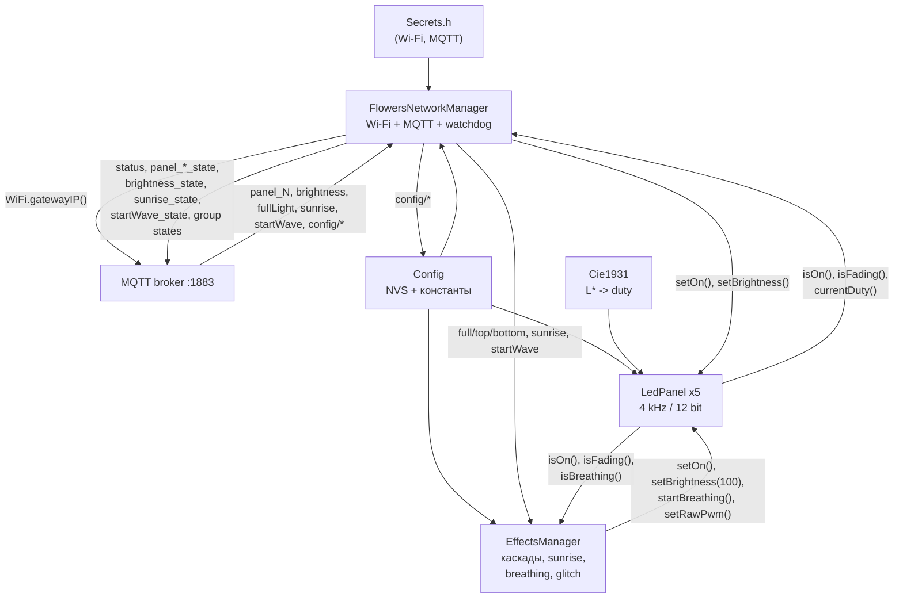

# x18.flowers — умный свет для цветочного стеллажа

Прошивка ESP32-C3 SuperMini для пяти светодиодных полок стеллажа с растениями.
Проект вырос из рабочей монолитной прошивки [`docs/main.cpp`](docs/main.cpp) и
постепенно переводится на модульную архитектуру по [`PRD.md`](PRD.md).

Текущее состояние: **все 6 блоков реализованы** (конфигурация,
CIE1931/LedPanel, NetworkManager, роутинг MQTT/anti-echo, каскады и «Рассвет»,
«Дыхание» и «Glitch»). Остаётся проверка на реальном железе.
README обновляется при каждом изменении прошивки.

---

## 1. Что это за проект и зачем он нужен

Стеллаж с растениями освещается пятью светодиодными панелями 12 В / 0,6 А.
Панели включаются N-MOSFET-транзисторами, а яркостью управляет ESP32-C3 через
ШИМ. Устройство подключено к Wi-Fi и управляется через MQTT из системы умного
дома (Home Assistant и совместимые).

Задачи прошивки:

- включать и выключать каждую полку отдельно;
- задавать индивидуальную и общую яркость;
- плавно менять яркость без визуальных рывков;
- управлять группами «весь стеллаж», «верх», «низ»;
- имитировать рассвет, «дыхание» и электрические помехи;
- публиковать состояние и телеметрию в MQTT;
- переживать пропадание Wi-Fi/брокера без «зависания» в нерабочем состоянии.

Ключевая особенность — **воспринимаемая** яркость. Человеческий глаз видит
свет нелинейно, поэтому линейный ШИМ даёт рывок внизу и почти незаметные
изменения вверху. Прошивка переводит процент воспринимаемой яркости `L*` в
12-битный duty cycle по кривой CIE 1931 и плавно интерполирует именно `L*`.

---

## 2. Целевой функционал

| Возможность | Состояние |
| :--- | :--- |
| Индивидуальное включение/выключение полок | ✅ Блок 4 |
| Индивидуальная яркость каждой полки (1–100 %) | ✅ Блоки 2, 4 |
| Глобальная яркость | ✅ Блок 4 |
| Группы: весь стеллаж, верх (3–5), низ (1–2) | ✅ Блоки 3, 5 |
| Каскадные волны включения/выключения | ✅ Блок 5 |
| Режим «Рассвет» | ✅ Блок 5 |
| «Дыхание» каждые 8–10 минут | ✅ Блок 6 |
| Электрические помехи каждые 3–4 минуты | ✅ Блок 6 |
| Настройка `fadeTime` и `interval` с сохранением в NVS | ✅ Блоки 1, 4 |
| Телеметрия `status` каждые 10 секунд | ✅ Блок 3 |
| Групповые статусы `fullLight_state`, `topLight_state`, `bottomLight_state` | ✅ Блок 3 |
| Watchdog связи 180 секунд | ✅ Блок 3 |
| Защита от эха MQTT (anti-echo) | ✅ Блок 4 |

---

## 3. Аппаратная платформа

### 3.1. Состав

- **МК:** ESP32-C3 SuperMini, board `esp32-c3-devkitm-1`.
- **Панели:** 5 шт., 12 В / 0,6 А.
- **Силовая часть:** N-MOSFET **IRLR7843PBF**, резистор 100 Ом в затворе,
  10 кОм затвор–GND.
- **Питание:** 12 В БП + DC-DC Mini-360 (5 В на пин `5V` ESP32).
- **Общий GND** ESP32 и силовой части обязателен.

Физическое устройство уже собрано и смонтировано на стеллаже. Перепайка и
смена пинов не предусмотрены.

### 3.2. Распиновка

| Полка | Положение | GPIO |
| :---: | :--- | :---: |
| 1 | низ | 0 |
| 2 | | 1 |
| 3 | | 3 |
| 4 | | 4 |
| 5 | верх | 10 |

**Важно:** `GPIO 2`, `GPIO 8`, `GPIO 9` — strapping-пины. Их нельзя использовать
для затворов: подтяжка 10 кОм к GND на GPIO 2 переводит чип в режим загрузки.
Пины заданы один раз в [`include/Config.h`](include/Config.h) и продублированы в
`panels[cfg::kPanelCount]` в [`src/main.cpp`](src/main.cpp).

### 3.3. ШИМ

- Частота: **4000 Гц**.
- Разрешение: **12 бит** (`0..4095`).
- Аппаратный предел LEDC ESP32-C3 при 4 кГц — 14 бит; используется 12 бит,
  чтобы совпадать с контрактом и оставить запас.
- Arduino Core 3.x: `ledcAttach(pin, freq, resolution)` / `ledcWrite(pin, duty)`.
  Для Core 2.x в `LedPanel.cpp` оставлен fallback на канальный API.

---

## 4. Архитектура прошивки

```
├── include/
│   ├── Config.h            # Константы пинов, ШИМ, топиков, таймингов; NVS-настройки
│   ├── Secrets.h           # Wi-Fi/MQTT-учётки (в .gitignore, в Git не попадает)
│   ├── Secrets.h.example   # Шаблон секретов
│   ├── Cie1931.h           # Кривая CIE1931: L* -> 12-битный duty
│   ├── LedPanel.h          # Одна полка: фейдинг, дыхание, raw PWM
│   ├── NetworkManager.h    # Wi-Fi, MQTT, watchdog, телеметрия, группы
│   └── EffectsManager.h    # Каскады, «Рассвет», «Дыхание», Glitch
├── src/
│   ├── main.cpp            # setup() и диспетчеризация loop()
│   ├── Config.cpp          # Preferences (NVS): fadeTime, interval
│   ├── LedPanel.cpp        # Реализация FSM полки
│   ├── NetworkManager.cpp  # Сеть, MQTT-подключение, телеметрия
│   └── EffectsManager.cpp  # Волновой секвенсор, sunrise, breathing, glitch
├── test/
│   └── test_cie1931.cpp    # Host-тесты кривой (Unity, native env)
├── docs/
│   └── main.cpp            # Исходный рабочий монолит (референс, секреты вырезаны)
├── graphify-out/           # Граф зависимостей проекта
├── PRD.md                  # Исходное ТЗ
└── platformio.ini
```

`EffectsManager` реализован в Блоках 5–6: каскады групп, «Рассвет»,
«Дыхание» и «Glitch». Все команды и эффекты подключены к `main.cpp`.

### 4.1. Ответственность модулей

- **Config** — единственное место с константами оборудования и топиков; читает
  и валидирует `fadeTime` / `interval` из NVS (`namespace "flowers"`).
- **Cie1931** — чистый header без Arduino-зависимостей: удобно тестировать на
  хосте.
- **LedPanel** — конечный автомат одной полки. Хранит `_panelBrightnessPercent`,
  текущий `L*`, duty, флаги фейдинга/дыхания и события изменения состояния.
- **NetworkManager** — Wi-Fi STA, MQTT, динамический адрес брокера, watchdog,
  групповая логика, JSON-телеметрия, роутинг команд и anti-echo.
  Класс называется `FlowersNetworkManager`, потому что в Arduino Core 3.x уже
  есть глобальный класс `NetworkManager` в библиотеке `Network`.
- **EffectsManager** — каскадный волновой секвенсор групп, автомат «Рассвета»,
  периодическая волна «Дыхания» и генератор «Glitch» с точным восстановлением
  ШИМ. Останавливает эффекты при ручном вмешательстве.
- **main.cpp** — только инициализация и вызовы `panel.update()`,
  `effects.update()` и `network.update()`.

### 4.2. Поток данных



Callback `PubSubClient` подключён в Блоке 4. Все групповые команды, «Рассвет»,
«Дыхание» и «Glitch» исполняются через `EffectsManager` (Блоки 5–6).

---

## 5. Математика света: CIE 1931

Для воспринимаемой яркости `L*` в процентах:

```
Y = L* / 902.3                      при L* <= 8
Y = ((L* + 16) / 116)^3             при L* > 8

PWM = round(Y * 4095)
```

Реализация: [`include/Cie1931.h`](include/Cie1931.h).

Контрольные значения:

| L*, % | Y | PWM |
| ---: | ---: | ---: |
| 0 | 0.000000 | 0 |
| 1 | 0.001108 | 5 |
| 8 | 0.008866 | 36 |
| 50 | 0.184187 | **754** |
| 100 | 1.000000 | 4095 |

В PRD для 50 % указано «≈ 755»; формула даёт `round(0.1841865 × 4095) = 754`.
Это расхождение в 1 LSB, тест допускает ±2.

**Плавность.** Фейдинг не интерполирует duty. Он интерполирует `L*` от текущего
значения к целевому ровно за **200 шагов**, и на каждом шаге вызывает
`percentToDuty()`. Поэтому внизу диапазона нет рывка, а вверху — нет
«мёртвой зоны».

---

## 6. Сеть и MQTT

### 6.1. Подключение

- **Брокер:** адрес не хардкодится. После подключения к Wi-Fi берётся
  `IPAddress brokerIP = WiFi.gatewayIP();` (брокер на MikroTik является
  шлюзом по умолчанию), порт `1883`.
- **Client ID:** строго `flowers-esp32`.
- **База топиков:** `home/flat7/flowers/`.
- **Wi-Fi:** `WiFi.setSleep(false)` и `WiFi.setTxPower(WIFI_POWER_19_5dBm)` —
  обязательны для стабильности C3 SuperMini со слабой керамической антенной.
- **MQTT-буфер:** 512 байт (JSON телеметрии с пятью полками не влезает в
  дефолтные 256 байт надёжно).
- **Таймауты:** socket timeout 2 с, попытка MQTT-подключения не чаще 1 раза в
  5 с, Wi-Fi reconnect — раз в 10 с. Главный цикл не блокируется надолго.
- **Подписка:** `home/flat7/flowers/#`. Callback `PubSubClient` подключён:
  команды разбираются по точному суффиксу топика, состояния фильтруются
  anti-echo-логикой (см. 6.4).

### 6.2. Контракт топиков

| Топик | Тип | Payload | Retain | Этап |
| :--- | :--- | :--- | :---: | :---: |
| `.../panel_[1..5]` | CMD | `ON` / `OFF` | нет | **4** |
| `.../panel_[1..5]_state` + дубль в `.../panel_[1..5]` | STATE | `ON` / `OFF` | да | **4** |
| `.../panel_[1..5]/brightness` | CMD | `1..100` | нет | **4** |
| `.../panel_[1..5]/brightness_state` | STATE | `1..100` | да | **4** |
| `.../brightness` | CMD | `1..100` | нет | **4** |
| `.../brightness_state` | STATE | `1..100` | да | **4** |
| `.../fullLight` | CMD | `ON` / `OFF` | нет | **5** |
| `.../fullLight_state` | STATE | `ON` / `OFF` | да | **3** |
| `.../topLight` | CMD | `ON` / `OFF` | нет | **5** |
| `.../topLight_state` | STATE | `ON` / `OFF` | да | **3** |
| `.../bottomLight` | CMD | `ON` / `OFF` | нет | **5** |
| `.../bottomLight_state` | STATE | `ON` / `OFF` | да | **3** |
| `.../sunrise` | CMD | `ON` / `OFF` | нет | **5** |
| `.../sunrise_state` | STATE | `ON` / `OFF` | да | **5** |
| `.../startWave` | CMD | `GO` (любой) | нет | **6** |
| `.../startWave_state` | STATE | `ON` / `OFF` | да | **6** |
| `.../config/fadeTime` | CMD | `0.1..10.0` | нет | **4** |
| `.../config/interval` | CMD | `0.0..5.0` | нет | **4** |
| `.../config/reboot` | CMD | `ON` | нет | **4** |
| `.../status` | STATE | JSON | нет | **3** |

Групповая логика:

- `bottomLight_state` = `ON`, если включена полка 1 или 2;
- `topLight_state` = `ON`, если включена полка 3, 4 или 5;
- `fullLight_state` = `ON`, если включена хотя бы одна полка.

Статусы публикуются при изменении и принудительно — после каждого подключения
к MQTT, чтобы брокер получил актуальную картину. Групповые команды
`fullLight` / `topLight` / `bottomLight` выполняются каскадом через
`EffectsManager`; `sunrise` управляет автоматом «Рассвета», `startWave` —
волной «Дыхания».

### 6.3. Телеметрия

Топик `home/flat7/flowers/status`, каждые **10 секунд**, `retain = false`:

```json
{
  "system": {
    "free_ram": 224224,
    "uptime": 396350,
    "sunrise_mode": "OFF"
  },
  "config": {
    "fade_s": 2.0,
    "int_s": 0.5
  },
  "brightness": 80,
  "panels": {
    "p1": "ON",
    "p2": "ON",
    "p3": "OFF",
    "p4": "OFF",
    "p5": "OFF"
  }
}
```

Особенности:

- `sunrise_mode` принимает `"ACTIVE"` во время рассвета и `"OFF"` иначе —
  так работает действующая прошивка. Флаг обновляется `EffectsManager` при
  старте/остановке/завершении «Рассвета».
- `startWave_state` публикуется отдельно: `ON` на всё время «Дыхания», `OFF`
  после возврата последней полки.
- Во время «Рассвета» глобальная яркость и яркость всех полок сбрасываются
  на 100 %, поэтому `brightness` в телеметрии равен 100.
- `brightness` — глобальная яркость (по умолчанию 100). Обновляется командой
  `.../brightness`; индивидуальные изменения яркости полок её не меняют.
- `panels.pN` отражает логическое состояние полки (`isOn()`), а не мгновенный
  duty во время фейдинга.
- NVS-настройки читаются из `Config`, поэтому JSON всегда соответствует
  фактическим значениям.
- После подключения к MQTT публикуется полный набор retained-состояний:
  `panel_N_state`, дубль `panel_N`, `panel_N/brightness_state`,
  `brightness_state`, `sunrise_state`, `startWave_state`, групповые статусы и
  `status`.

### 6.4. Anti-echo и защита от зацикливания

Подписка на `home/flat7/flowers/#` возвращает устройству его же публикации.
Обработчик сравнивает входящую команду с текущим целевым состоянием и
игнорирует совпадение:

- **`panel_N`** — `ON`/`OFF` сравнивается с `panel.isOn()`. Совпадение
  игнорируется. Это критично: состояние дублируется в `panel_N` для обратной
  совместимости, и собственная публикация приходит обратно как команда.
- **`panel_N/brightness`** — сравнивается с `panel.brightnessPercent()`
  (целевой яркостью, а не текущим duty).
- **`brightness`** — применяется, только если глобальное значение или
  яркость хотя бы одной полки отличается. Это позволяет повторной командой
  синхронизировать полки после индивидуальных изменений.
- **State-топики** — `panel_N_state`, `panel_N/brightness_state`,
  `brightness_state`, `status`, `*Light_state`, `sunrise_state`,
  `startWave_state` — не являются командами и игнорируются.
- **`config/*`** — повтор значения игнорируется, как и любая команда,
  совпадающая с текущей настройкой.

Публикации состояний выполняются с `retain=true`, но не порождают команд,
поэтому шторма сообщений нет.

### 6.5. Обработка команд (Блок 4)

| Топик | Обработка |
| :--- | :--- |
| `panel_N` | Проверка `ON`/`OFF`; `setOn(..., fadeTime)`; публикация `panel_N_state` и дубля `panel_N`; обновление групповых статусов |
| `panel_N/brightness` | Целое `1..100`; при `ON` — плавный переход, при `OFF` — запоминание; публикация `panel_N/brightness_state` |
| `brightness` | Целое `1..100`; применяется ко всем полкам, обновляет `globalBrightnessPercent`; публикует `brightness_state` и яркость каждой полки |
| `config/fadeTime` | Float `0.1..10.0`; валидация, запись в NVS, немедленная публикация `status` |
| `config/interval` | Float `0.0..5.0`; валидация, запись в NVS, немедленная публикация `status` |
| `config/reboot` | `ON`; публикация `status`, пауза 500 мс, `ESP.restart()` |

Некорректные payload'ы логируются в Serial и не применяются. State-топики и
неизвестные топики игнорируются.

### 6.6. Групповые команды и «Рассвет» (Блок 5)

| Топик | Обработка |
| :--- | :--- |
| `fullLight ON` | Каскад 1 → 5 с интервалом `interval`; если «Рассвет» активен — команда игнорируется |
| `fullLight OFF` | Остановка «Рассвета» (если активен) и каскад 5 → 1 |
| `topLight ON` | Остановка «Рассвета», каскад полок 3 → 4 → 5 |
| `topLight OFF` | Остановка «Рассвета», каскад 5 → 4 → 3 |
| `bottomLight ON` | Остановка «Рассвета», каскад 1 → 2 |
| `bottomLight OFF` | Остановка «Рассвета», каскад 2 → 1 |
| `sunrise ON` | Запуск, только если все 5 полок выключены и не фейдятся |
| `sunrise OFF` | Остановка «Рассвета», все полки плавно выключаются |

Любая ручная команда полки, яркости или глобальной яркости, которая меняет
состояние, вызывает `EffectsManager::onManualOverride()`: «Рассвет»
останавливается, активный каскад отменяется, после чего применяется ручная
команда.

Автомат «Рассвета»:

1. Проверка, что все полки выключены; иначе отказ.
2. Яркость всех полок и глобальная яркость выставляются в 100 %.
3. Публикуется `sunrise_state = ON`.
4. Полка 1 стартует сразу, полки 2–5 — через 120/240/360/480 с.
5. Каждая полка разгорается 360 с по CIE1931.
6. Через 840 с (`kSunriseDurationMs`) публикуется `sunrise_state = OFF`,
   полки остаются включёнными на 100 %.
7. Любая OFF-команда/ручное вмешательство сбрасывает автомат и плавно
   выключает все полки.

### 6.7. «Дыхание» и «Glitch» (Блок 6)

| Топик | Обработка |
| :--- | :--- |
| `startWave` | Принудительный запуск «Дыхания»; payload любой. Условия: не «Рассвет», не каскад, не Glitch, все 5 полок `ON`. При успехе таймер автозапуска сбрасывается |

Автоматика:

- **«Дыхание»** — каждые 8–10 минут (`random(480, 600)` с), если все 5 полок
  включены, не активны «Рассвет», каскад и Glitch. Направление случайное.
  Каждая полка с интервалом `interval` гаснет до 0 % и возвращается к своей
  индивидуальной яркости; `startWave_state = ON` до возврата последней полки.
- **Glitch** — каждые 180–240 с. Выбирается случайная включённая и не
  фейдящаяся полка при любой яркости (включая 100 %). Длительность 200–500 мс,
  провалы каждые 30–100 мс в 0 или в 2–4 раза ниже текущего duty через
  `setRawPwm()`, затем точное восстановление исходного CIE1931-ШИМ.

Ручная команда полки/яркости или групповая команда отменяют активные
«Дыхание»/Glitch: панели возвращаются к своей яркости, ШИМ восстанавливается.
«Рассвет» запускается только с полностью выключенного стеллажа, поэтому к
моменту его старта эти эффекты уже не активны.

---

## 7. Эффекты

Все эффекты реализованы: каскады `fullLight` / `topLight` / `bottomLight`,
«Рассвет» (Блок 5), «Дыхание» и Glitch (Блок 6).

### 7.1. Рассвет (реализован)

- Запуск по `.../sunrise` = `ON` только если **все 5 полок выключены** и не
  находятся в фейдинге.
- Сбрасывает яркость всех полок и глобальную яркость на 100 %.
- Полки стартуют снизу вверх (1 → 5) с интервалом **120 с**; первая — сразу.
- Каждая разгорается от 0 до 100 % по CIE1931 за **360 с**.
- Полный цикл: 4 × 120 + 360 = **840 с (14 минут)**.
- По завершении `sunrise_state = OFF`, полки остаются включёнными.
- Прерывается командой выключения группы/«Рассвета» (`fullLight OFF`,
  `sunrise OFF`, `topLight OFF`, `bottomLight OFF`) или ручным изменением
  состояния полки/яркости. При прерывании все полки плавно выключаются,
  `sunrise_state = OFF`.

### 7.2. «Дыхание» (волна) — реализовано

- Условия: не активен «Рассвет», нет каскада/Glitch, все 5 полок `ON`; уровень
  яркости **не важен**.
- Автозапуск каждые 8–10 минут (`random(480, 600)` с) или вручную по
  `.../startWave`; успешный ручной запуск сбрасывает таймер.
- Случайное направление `UP`/`DOWN`.
- Каждая полка с интервалом `interval` плавно гаснет до 0 % и сразу
  возвращается к **своей** установленной яркости.
- `startWave_state = ON` на время прохождения и до возврата последней полки,
  затем `OFF` (retain).
- Ручная команда/группа/«Рассвет» отменяют волну; панели возвращаются к своей
  яркости.

### 7.3. Электрические помехи (Glitch) — реализовано

- Условия: не активны «Рассвет», каскад и «Дыхание»; яркость любая; случайная
  включённая полка не находится в фейдинге.
- Каждые **180–240 с**.
- Длительность **200–500 мс**, провалы каждые 30–100 мс в 0 или в 2–4 раза ниже
  текущего duty через `setRawPwm()`.
- По завершении — точное восстановление сохранённого ШИМ (значение CIE1931).
- Glitch не меняет логическое состояние полки и не влияет на телеметрию.

### 7.4. Каскадные волны (реализованы)

- `fullLight ON`: 1 → 5, `OFF`: 5 → 1.
- `topLight ON`: 3 → 4 → 5, `OFF`: 5 → 4 → 3.
- `bottomLight ON`: 1 → 2, `OFF`: 2 → 1.
- Первая полка реагирует сразу, остальные — с интервалом `interval` из NVS.
- `fullLight ON` не прерывает активный «Рассвет»; `fullLight OFF` и команды
  `topLight`/`bottomLight` — прерывают.
- Ручная команда полки/яркости отменяет активный каскад.

---

## 8. Защитные механизмы и нюансы

- **Стартовая пауза 5 секунд** в `setup()` — гарантирует доступ к USB-CDC при
  отладке. Не убирать: без неё первые логи теряются.
- **Watchdog связи**: если Wi-Fi или MQTT отсутствуют непрерывно более
  **180 000 мс**, выполняется `ESP.restart()`.
- **Секреты**: реальные `WIFI_SSID`, `WIFI_PASS`, `MQTT_USER`, `MQTT_PASS`
  лежат только в `include/Secrets.h`. Файл в `.gitignore`; в репозитории есть
  только `Secrets.h.example`. `docs/main.cpp` очищен от реальных значений.
- **Пины**: только `{0, 1, 3, 4, 10}`. `GPIO 2/8/9` не использовать.
- **NVS**: значения `fadeTime` (0.1–10.0 с) и `interval` (0.0–5.0 с)
  валидируются при чтении и записи; некорректные значения заменяются
  дефолтными (2.0 и 0.5 с).
- **ШИМ**: 4 кГц / 12 бит. Уменьшение разрешения или повышение частоты сверх
  возможностей LEDC недопустимо.
- **Anti-echo**: реализован в Блоке 4. Собственные state-сообщения не
  воспринимаются как команды; повтор команды с тем же целевым состоянием или
  яркостью игнорируется.
- **Приоритет эффектов**: активный «Рассвет» блокирует `fullLight ON`; любая
  OFF-команда группы/«Рассвета» или ручное изменение состояния останавливает
  «Рассвет» и отменяет каскад. После остановки «Рассвета» все полки плавно
  выключаются. «Дыхание» и Glitch при этом отменяются: полки возвращаются к
  своей яркости, исходный ШИМ восстанавливается.
- **Glitch и ШИМ**: провалы выполняются только через `setRawPwm()` и не меняют
  `_currentDuty` полки; после эффекта восстанавливается точное значение,
  рассчитанное по CIE1931.
- **Динамический брокер**: IP брокера не хранится в коде и не задаётся вручную;
  только `WiFi.gatewayIP()`.
- **MQTT-retain**: состояния (`*_state`) — `retain=true`, телеметрия `status` —
  `retain=false`, команды не retained.

---

## 9. Сборка, прошивка, тесты

### 9.1. Требования

- PlatformIO Core (CLI) или PlatformIO IDE.
- USB-кабель к ESP32-C3 SuperMini (native USB-CDC).
- PlatformIO-платформа `espressif32@8.0.0` (закреплена в `platformio.ini`),
  Arduino Core 3.x.
- Библиотеки: `knolleary/PubSubClient@^2.8`, `bblanchon/ArduinoJson@^7.0`.

### 9.2. Секреты

```bash
cp include/Secrets.h.example include/Secrets.h
$EDITOR include/Secrets.h
```

Заполните `WIFI_SSID`, `WIFI_PASS`, `MQTT_USER`, `MQTT_PASS`.
Файл `include/Secrets.h` уже в `.gitignore` — коммитить его нельзя.

### 9.3. Сборка и прошивка

```bash
pio run                     # сборка
pio run -t upload           # прошивка
pio device monitor -b 115200
```

В `platformio.ini` заданы `monitor_speed = 115200`, `upload_speed = 115200`,
`ARDUINO_USB_CDC_ON_BOOT=1`, `ARDUINO_USB_MODE=1`.

### 9.4. Тесты

```bash
pio test -e native
```

`native` env собирает только host-тесты (без Arduino), `test_build_src = no`.
Сейчас проверяется математика CIE1931: endpoints, середина, монотонность,
нижний нелинейный участок, clamping/NaN, обратное преобразование.

### 9.5. Граф зависимостей

```bash
graphify update .
```

Результат — `graphify-out/graph.json`, `graph.html`, `GRAPH_REPORT.md`.
После каждого блока граф обновляется и коммитится.

---

## 10. Текущий статус

| Блок | Содержание | Статус |
| :---: | :--- | :---: |
| 1 | Аудит монолита, `platformio.ini`, `Secrets.h`, `Config`/NVS | ✅ |
| 2 | `Cie1931`, `LedPanel`, индивидуальная яркость, 200-шаговый фейдинг | ✅ |
| 3 | `NetworkManager`: Wi-Fi, динамический gateway, watchdog, телеметрия, группы | ✅ |
| 4 | Роутинг MQTT, anti-echo, полки, глобальная яркость, конфиг-команды | ✅ |
| 5 | `EffectsManager`: каскады и «Рассвет» | ✅ |
| 6 | «Дыхание», «Glitch», финализация | ✅ |

Что уже работает после Блока 6:

- загрузка NVS-настроек и инициализация пяти полок (все выключены);
- подключение к Wi-Fi с отключённым сном и максимальной мощностью;
- MQTT-подключение к `WiFi.gatewayIP():1883` с Client ID `flowers-esp32`;
- разбор входящих топиков с anti-echo;
- индивидуальное включение/выключение полок и индивидуальная яркость;
- глобальная яркость для всех полок;
- каскады `fullLight` / `topLight` / `bottomLight` с интервалом из NVS;
- «Рассвет»: старт снизу вверх, 120 с между полками, 360 с на разгорание,
  14 минут, `sunrise_state`, корректное прерывание;
- «Дыхание» каждые 8–10 минут или по `startWave`, с возвратом к собственной
  яркости и `startWave_state`;
- Glitch каждые 180–240 с при любой яркости с точным восстановлением ШИМ;
- настройка `fadeTime` / `interval` через MQTT с сохранением в NVS;
- программная перезагрузка по `config/reboot`;
- публикация `panel_N_state`, дубля `panel_N`, `panel_N/brightness_state`,
  `brightness_state`, `sunrise_state`, `startWave_state`, групповых статусов
  и `status`;
- watchdog 180 с.

Все 6 блоков PRD реализованы. Дальнейшие шаги — проверка на реальном стеллаже:
живой MQTT-loopback, тайминги «Рассвета»/«Дыхания» и визуальная проверка
Glitch на разных уровнях яркости.

---

## 11. Правила разработки

Подробно — в [`AGENTS.md`](AGENTS.md). Кратко:

1. **Коммиты — на русском языке**, с описанием того, что сделано в итерации.
2. **Любое изменение прошивки сопровождается правкой README.md**: статус,
   новые модули/топики/нюансы, журнал изменений.
3. Перед коммитом: `pio run` и `pio test -e native`; критерии приёмки блока
   должны быть выполнены.
4. После блока: `graphify update .`, коммит, `git push`, пауза на ревью.
5. Секреты — только в `include/Secrets.h`; в Git их быть не должно.
6. Пины `{0,1,3,4,10}` и параметры ШИМ 4 кГц / 12 бит не менять без перепайки
   и пересмотра ТЗ.

---

## 12. Журнал изменений

### Блок 6 — «Дыхание», Glitch и финализация

- В `EffectsManager` добавлена периодическая волна «Дыхания»: автозапуск
  каждые 8–10 минут или вручную по `startWave`, случайное направление, возврат
  каждой полки к её собственной яркости.
- `startWave_state` публикуется с `retain=true`: `ON` на время волны, `OFF`
  после возврата последней полки.
- Добавлен Glitch: каждые 180–240 с на случайной включённой и не фейдящейся
  полке при любой яркости; провалы 200–500 мс через `setRawPwm()` и точное
  восстановление исходного CIE1931-ШИМ.
- Ручные команды, группы и «Рассвет» отменяют «Дыхание»/Glitch с возвратом
  яркости и восстановлением ШИМ.
- `NetworkManager` получил `publishStartWaveState()` и диспетчеризацию
  `startWave`.
- `main.cpp` финализирован: только инициализация и диспетчеризация
  `panel.update()`, `effects.update()`, `network.update()`.
- README обновлён под Блок 6; все 6 блоков PRD реализованы.

### Блок 5 — каскады и «Рассвет»

- Добавлены `include/EffectsManager.h` и `src/EffectsManager.cpp`.
- Волновой секвенсор групп: `fullLight` (1→5 / 5→1), `topLight` (3→4→5 /
  5→4→3), `bottomLight` (1→2 / 2→1), первая полка — сразу, далее с
  `interval` из NVS.
- «Рассвет»: запуск только со полностью выключенного стеллажа, сброс яркости
  на 100 %, старт полок через 120 с, разгорание 360 с по CIE1931, полный цикл
  840 с, `sunrise_state` с retain.
- Прерывание «Рассвета» любым OFF/ручным вмешательством: автомат
  сбрасывается, все полки плавно выключаются.
- `fullLight ON` не прерывает «Рассвет»; `topLight`/`bottomLight` и
  `fullLight OFF` — прерывают.
- Ручная команда полки/яркости отменяет активный каскад.
- `NetworkManager` получил `setEffectsManager()`, `publishSunriseState()` и
  диспетчеризацию групповых/sunrise-команд.
- README обновлён под Блок 5.

### Блок 4 — роутинг MQTT и anti-echo

- Подключён callback `PubSubClient`; топики разбираются по точному суффиксу,
  а не поиском `panel_` в строке.
- Индивидуальные команды `panel_N` (`ON`/`OFF`) и
  `panel_N/brightness` (`1..100`).
- Публикация `panel_N_state`, дубля `panel_N` и `panel_N/brightness_state`
  с `retain=true`.
- Глобальная яркость `brightness`: применяется ко всем полкам, публикует
  `brightness_state` и индивидуальные brightness-state.
- `config/fadeTime`, `config/interval` с валидацией и записью в NVS,
  `config/reboot` с программной перезагрузкой.
- Anti-echo: совпадение с целевым состоянием/яркостью игнорируется;
  собственные state-топики не исполняются как команды.
- После MQTT-подключения публикуется полный набор retained-состояний.
- Групповые команды и эффекты зарезервированы до Блоков 5–6.

### Блок 3 — NetworkManager

- Добавлены `include/NetworkManager.h` и `src/NetworkManager.cpp`.
- Wi-Fi STA: `setSleep(false)`, `WIFI_POWER_19_5dBm`, ретраи подключения.
- Адрес брокера — `WiFi.gatewayIP()`, Client ID `flowers-esp32`.
- Watchdog 180 с, неблокирующие переподключения Wi-Fi/MQTT.
- Телеметрия `status` раз в 10 с, групповые `*_state` с retain.
- Класс назван `FlowersNetworkManager` из-за конфликта с `NetworkManager`
  в Arduino Core 3.x.
- README и правила разработки добавлены/обновлены.

### Блок 2 — CIE1931 и LedPanel

- `include/Cie1931.h`: формула CIE1931, `percentToDuty`, `dutyToPercent`.
- `include/LedPanel.h` / `src/LedPanel.cpp`: индивидуальная яркость, 200-шаговый
  фейдинг по `L*`, дыхание, raw PWM, события для сети.
- `test/test_cie1931.cpp`, native env, 6 тестов.
- В `main.cpp` добавлены пять полок и boot-проверка CIE.

### Блок 1 — фундамент

- `platformio.ini` под ESP32-C3, USB-CDC, PubSubClient, ArduinoJson.
- `include/Secrets.h` (игнорируется), `Secrets.h.example`, `.gitignore`.
- `Config.h` / `Config.cpp`: константы и NVS (`fadeTime`, `interval`).
- `docs/main.cpp` очищен от реальных учётных данных.
- Первый граф graphify.
