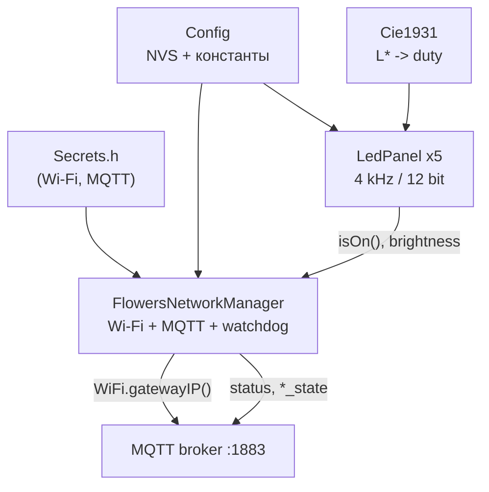

# x18.flowers — умный свет для цветочного стеллажа

Прошивка ESP32-C3 SuperMini для пяти светодиодных полок стеллажа с растениями.
Проект вырос из рабочей монолитной прошивки [`docs/main.cpp`](docs/main.cpp) и
постепенно переводится на модульную архитектуру по [`PRD.md`](PRD.md).

Текущее состояние: **Блоки 1–3 из 6** (конфигурация, CIE1931/LedPanel,
NetworkManager). Обработка MQTT-команд и эффекты появятся в Блоках 4–6.
README обновляется при каждом изменении прошивки.

---

## 1. Что это за проект и зачем он нужен

Стеллаж с растениями освещается пятью светодиодными панелями 12 В / 0,6 А.
Панели включаются N-MOSFET-транзисторами, а яркостью управляет ESP32-C3 через
ШИМ. Устройство подключено к Wi-Fi и управляется через MQTT из системы умного
дома (Home Assistant и совместимые).

Задачи прошивки:

- включать и выключать каждую полку отдельно;
- задавать индивидуальную и общую яркость;
- плавно менять яркость без визуальных рывков;
- управлять группами «весь стеллаж», «верх», «низ»;
- имитировать рассвет, «дыхание» и электрические помехи;
- публиковать состояние и телеметрию в MQTT;
- переживать пропадание Wi-Fi/брокера без «зависания» в нерабочем состоянии.

Ключевая особенность — **воспринимаемая** яркость. Человеческий глаз видит
свет нелинейно, поэтому линейный ШИМ даёт рывок внизу и почти незаметные
изменения вверху. Прошивка переводит процент воспринимаемой яркости `L*` в
12-битный duty cycle по кривой CIE 1931 и плавно интерполирует именно `L*`.

---

## 2. Целевой функционал

| Возможность | Состояние |
| :--- | :--- |
| Индивидуальное включение/выключение полок | Блок 4 |
| Индивидуальная яркость каждой полки (1–100 %) | Блок 2 (модель), Блок 4 (MQTT) |
| Глобальная яркость | Блок 4 |
| Группы: весь стеллаж, верх (3–5), низ (1–2) | Блоки 4–5 |
| Каскадные волны включения/выключения | Блок 5 |
| Режим «Рассвет» | Блок 5 |
| «Дыхание» каждые 8–10 минут | Блок 6 |
| Электрические помехи каждые 3–4 минуты | Блок 6 |
| Настройка `fadeTime` и `interval` с сохранением в NVS | Блоки 1, 4 |
| Телеметрия `status` каждые 10 секунд | Блок 3 |
| Групповые статусы `fullLight_state`, `topLight_state`, `bottomLight_state` | Блок 3 |
| Watchdog связи 180 секунд | Блок 3 |
| Защита от эха MQTT (anti-echo) | Блок 4 |

---

## 3. Аппаратная платформа

### 3.1. Состав

- **МК:** ESP32-C3 SuperMini, board `esp32-c3-devkitm-1`.
- **Панели:** 5 шт., 12 В / 0,6 А.
- **Силовая часть:** N-MOSFET **IRLR7843PBF**, резистор 100 Ом в затворе,
  10 кОм затвор–GND.
- **Питание:** 12 В БП + DC-DC Mini-360 (5 В на пин `5V` ESP32).
- **Общий GND** ESP32 и силовой части обязателен.

Физическое устройство уже собрано и смонтировано на стеллаже. Перепайка и
смена пинов не предусмотрены.

### 3.2. Распиновка

| Полка | Положение | GPIO |
| :---: | :--- | :---: |
| 1 | низ | 0 |
| 2 | | 1 |
| 3 | | 3 |
| 4 | | 4 |
| 5 | верх | 10 |

**Важно:** `GPIO 2`, `GPIO 8`, `GPIO 9` — strapping-пины. Их нельзя использовать
для затворов: подтяжка 10 кОм к GND на GPIO 2 переводит чип в режим загрузки.
Пины заданы один раз в [`include/Config.h`](include/Config.h) и продублированы в
`panels[cfg::kPanelCount]` в [`src/main.cpp`](src/main.cpp).

### 3.3. ШИМ

- Частота: **4000 Гц**.
- Разрешение: **12 бит** (`0..4095`).
- Аппаратный предел LEDC ESP32-C3 при 4 кГц — 14 бит; используется 12 бит,
  чтобы совпадать с контрактом и оставить запас.
- Arduino Core 3.x: `ledcAttach(pin, freq, resolution)` / `ledcWrite(pin, duty)`.
  Для Core 2.x в `LedPanel.cpp` оставлен fallback на канальный API.

---

## 4. Архитектура прошивки

```
├── include/
│   ├── Config.h            # Константы пинов, ШИМ, топиков, таймингов; NVS-настройки
│   ├── Secrets.h           # Wi-Fi/MQTT-учётки (в .gitignore, в Git не попадает)
│   ├── Secrets.h.example   # Шаблон секретов
│   ├── Cie1931.h           # Кривая CIE1931: L* -> 12-битный duty
│   ├── LedPanel.h          # Одна полка: фейдинг, дыхание, raw PWM
│   └── NetworkManager.h    # Wi-Fi, MQTT, watchdog, телеметрия, группы
├── src/
│   ├── main.cpp            # setup() и диспетчеризация loop()
│   ├── Config.cpp          # Preferences (NVS): fadeTime, interval
│   ├── LedPanel.cpp        # Реализация FSM полки
│   └── NetworkManager.cpp  # Сеть, MQTT-подключение, телеметрия
├── test/
│   └── test_cie1931.cpp    # Host-тесты кривой (Unity, native env)
├── docs/
│   └── main.cpp            # Исходный рабочий монолит (референс, секреты вырезаны)
├── graphify-out/           # Граф зависимостей проекта
├── PRD.md                  # Исходное ТЗ
└── platformio.ini
```

Планируется добавить `EffectsManager.h/.cpp` (Блоки 5–6).

### 4.1. Ответственность модулей

- **Config** — единственное место с константами оборудования и топиков; читает
  и валидирует `fadeTime` / `interval` из NVS (`namespace "flowers"`).
- **Cie1931** — чистый header без Arduino-зависимостей: удобно тестировать на
  хосте.
- **LedPanel** — конечный автомат одной полки. Хранит `_panelBrightnessPercent`,
  текущий `L*`, duty, флаги фейдинга/дыхания и события изменения состояния.
- **NetworkManager** — Wi-Fi STA, MQTT, динамический адрес брокера, watchdog,
  групповая логика и JSON-телеметрия.
  Класс называется `FlowersNetworkManager`, потому что в Arduino Core 3.x уже
  есть глобальный класс `NetworkManager` в библиотеке `Network`.
- **main.cpp** — только инициализация и вызовы `panel.update()` /
  `network.update()`.

### 4.2. Поток данных



Обратные команды MQTT (`panel_N`, `brightness`, `fullLight`, …) будут подключены
в Блоке 4 через callback `PubSubClient`.

---

## 5. Математика света: CIE 1931

Для воспринимаемой яркости `L*` в процентах:

```
Y = L* / 902.3                      при L* <= 8
Y = ((L* + 16) / 116)^3             при L* > 8

PWM = round(Y * 4095)
```

Реализация: [`include/Cie1931.h`](include/Cie1931.h).

Контрольные значения:

| L*, % | Y | PWM |
| ---: | ---: | ---: |
| 0 | 0.000000 | 0 |
| 1 | 0.001108 | 5 |
| 8 | 0.008866 | 36 |
| 50 | 0.184187 | **754** |
| 100 | 1.000000 | 4095 |

В PRD для 50 % указано «≈ 755»; формула даёт `round(0.1841865 × 4095) = 754`.
Это расхождение в 1 LSB, тест допускает ±2.

**Плавность.** Фейдинг не интерполирует duty. Он интерполирует `L*` от текущего
значения к целевому ровно за **200 шагов**, и на каждом шаге вызывает
`percentToDuty()`. Поэтому внизу диапазона нет рывка, а вверху — нет
«мёртвой зоны».

---

## 6. Сеть и MQTT

### 6.1. Подключение

- **Брокер:** адрес не хардкодится. После подключения к Wi-Fi берётся
  `IPAddress brokerIP = WiFi.gatewayIP();` (брокер на MikroTik является
  шлюзом по умолчанию), порт `1883`.
- **Client ID:** строго `flowers-esp32`.
- **База топиков:** `home/flat7/flowers/`.
- **Wi-Fi:** `WiFi.setSleep(false)` и `WiFi.setTxPower(WIFI_POWER_19_5dBm)` —
  обязательны для стабильности C3 SuperMini со слабой керамической антенной.
- **MQTT-буфер:** 512 байт (JSON телеметрии с пятью полками не влезает в
  дефолтные 256 байт надёжно).
- **Таймауты:** socket timeout 2 с, попытка MQTT-подключения не чаще 1 раза в
  5 с, Wi-Fi reconnect — раз в 10 с. Главный цикл не блокируется надолго.
- **Подписка:** `home/flat7/flowers/#`. На текущем этапе подписка создаётся, но
  callback ещё не подключён — команды начнут исполняться в Блоке 4.

### 6.2. Контракт топиков

| Топик | Тип | Payload | Retain | Этап |
| :--- | :--- | :--- | :---: | :---: |
| `.../panel_[1..5]` | CMD | `ON` / `OFF` | нет | 4 |
| `.../panel_[1..5]_state` + дубль в `.../panel_[1..5]` | STATE | `ON` / `OFF` | да | 4 |
| `.../panel_[1..5]/brightness` | CMD | `1..100` | нет | 4 |
| `.../panel_[1..5]/brightness_state` | STATE | `1..100` | да | 4 |
| `.../brightness` | CMD | `1..100` | нет | 4 |
| `.../brightness_state` | STATE | `1..100` | да | 4 |
| `.../fullLight` | CMD | `ON` / `OFF` | нет | 4–5 |
| `.../fullLight_state` | STATE | `ON` / `OFF` | да | **3** |
| `.../topLight` | CMD | `ON` / `OFF` | нет | 4–5 |
| `.../topLight_state` | STATE | `ON` / `OFF` | да | **3** |
| `.../bottomLight` | CMD | `ON` / `OFF` | нет | 4–5 |
| `.../bottomLight_state` | STATE | `ON` / `OFF` | да | **3** |
| `.../sunrise` | CMD | `ON` / `OFF` | нет | 5 |
| `.../sunrise_state` | STATE | `ON` / `OFF` | да | 5 |
| `.../startWave` | CMD | `GO` (любой) | нет | 6 |
| `.../startWave_state` | STATE | `ON` / `OFF` | да | 6 |
| `.../config/fadeTime` | CMD | `0.1..10.0` | нет | 4 |
| `.../config/interval` | CMD | `0.0..5.0` | нет | 4 |
| `.../config/reboot` | CMD | `ON` | нет | 4 |
| `.../status` | STATE | JSON | нет | **3** |

Групповая логика:

- `bottomLight_state` = `ON`, если включена полка 1 или 2;
- `topLight_state` = `ON`, если включена полка 3, 4 или 5;
- `fullLight_state` = `ON`, если включена хотя бы одна полка.

Статусы публикуются при изменении и принудительно — после каждого подключения
к MQTT, чтобы брокер получил актуальную картину.

### 6.3. Телеметрия

Топик `home/flat7/flowers/status`, каждые **10 секунд**, `retain = false`:

```json
{
  "system": {
    "free_ram": 224224,
    "uptime": 396350,
    "sunrise_mode": "OFF"
  },
  "config": {
    "fade_s": 2.0,
    "int_s": 0.5
  },
  "brightness": 80,
  "panels": {
    "p1": "ON",
    "p2": "ON",
    "p3": "OFF",
    "p4": "OFF",
    "p5": "OFF"
  }
}
```

Особенности:

- `sunrise_mode` принимает `"ACTIVE"` во время рассвета и `"OFF"` иначе —
  так работает действующая прошивка. В Блоке 3 флаг всегда `OFF`.
- `brightness` — глобальная яркость (по умолчанию 100). Обновляется командой
  `.../brightness` в Блоке 4.
- `panels.pN` отражает логическое состояние полки (`isOn()`), а не мгновенный
  duty во время фейдинга.
- NVS-настройки читаются из `Config`, поэтому JSON всегда соответствует
  фактическим значениям.

### 6.4. Anti-echo (Блок 4)

Подписка на `home/flat7/flowers/#` возвращает устройству его же публикации.
Перед применением команды нужно сравнить её с текущим целевым состоянием или
яркостью и **игнорировать совпадение**. Иначе «Рассвет» будет прерываться
собственным сообщением, а брокер получит шторм публикаций.

---

## 7. Эффекты (целевое поведение, Блоки 5–6)

### 7.1. Рассвет

- Запуск по `.../sunrise` = `ON` только если **все 5 полок выключены**.
- Сбрасывает яркость всех полок на 100 %.
- Полки стартуют снизу вверх (1 → 5) с интервалом **120 с**.
- Каждая разгорается от 0 до 100 % по CIE1931 за **360 с**.
- Полный цикл: 4 × 120 + 360 = **840 с (14 минут)**.
- Прерывается любой командой выключения: `fullLight OFF`, `sunrise OFF`,
  ручное управление полкой.

### 7.2. «Дыхание» (волна)

- Условия: не активен «Рассвет», все 5 полок `ON`; уровень яркости **не важен**.
- Автозапуск каждые `random(480, 600)` секунд или вручную по `.../startWave`.
- Случайное направление `UP`/`DOWN`.
- Каждая полка с интервалом `cfgWaveIntervalSec` плавно гаснет до 0 % и сразу
  возвращается к **своей** установленной яркости.
- На время прохождения `startWave_state = ON`, после возврата последней полки —
  `OFF`.

### 7.3. Электрические помехи (Glitch)

- Условия: не активны «Рассвет» и «Волна»; яркость любая; случайная включённая
  полка не находится в фейдинге.
- Каждые **180–240 с**.
- Длительность **200–500 мс**, провалы каждые 30–100 мс в 0 или в 2–4 раза ниже
  текущего duty через `setRawPwm()`.
- По завершении — точное восстановление сохранённого ШИМ.

### 7.4. Каскадные волны

- `fullLight ON`: 1 → 5, `OFF`: 5 → 1.
- `topLight`: полки 3, 4, 5.
- `bottomLight`: полки 1, 2.
- Интервал между полками — `interval` из NVS.

---

## 8. Защитные механизмы и нюансы

- **Стартовая пауза 5 секунд** в `setup()` — гарантирует доступ к USB-CDC при
  отладке. Не убирать: без неё первые логи теряются.
- **Watchdog связи**: если Wi-Fi или MQTT отсутствуют непрерывно более
  **180 000 мс**, выполняется `ESP.restart()`.
- **Секреты**: реальные `WIFI_SSID`, `WIFI_PASS`, `MQTT_USER`, `MQTT_PASS`
  лежат только в `include/Secrets.h`. Файл в `.gitignore`; в репозитории есть
  только `Secrets.h.example`. `docs/main.cpp` очищен от реальных значений.
- **Пины**: только `{0, 1, 3, 4, 10}`. `GPIO 2/8/9` не использовать.
- **NVS**: значения `fadeTime` (0.1–10.0 с) и `interval` (0.0–5.0 с)
  валидируются при чтении и записи; некорректные значения заменяются
  дефолтными (2.0 и 0.5 с).
- **ШИМ**: 4 кГц / 12 бит. Уменьшение разрешения или повышение частоты сверх
  возможностей LEDC недопустимо.
- **Anti-echo**: обязателен, иначе собственные state-сообщения воспринимаются
  как команды.
- **Динамический брокер**: IP брокера не хранится в коде и не задаётся вручную;
  только `WiFi.gatewayIP()`.
- **MQTT-retain**: состояния (`*_state`) — `retain=true`, телеметрия `status` —
  `retain=false`, команды не retained.

---

## 9. Сборка, прошивка, тесты

### 9.1. Требования

- PlatformIO Core (CLI) или PlatformIO IDE.
- USB-кабель к ESP32-C3 SuperMini (native USB-CDC).
- PlatformIO-платформа `espressif32@8.0.0` (закреплена в `platformio.ini`),
  Arduino Core 3.x.
- Библиотеки: `knolleary/PubSubClient@^2.8`, `bblanchon/ArduinoJson@^7.0`.

### 9.2. Секреты

```bash
cp include/Secrets.h.example include/Secrets.h
$EDITOR include/Secrets.h
```

Заполните `WIFI_SSID`, `WIFI_PASS`, `MQTT_USER`, `MQTT_PASS`.
Файл `include/Secrets.h` уже в `.gitignore` — коммитить его нельзя.

### 9.3. Сборка и прошивка

```bash
pio run                     # сборка
pio run -t upload           # прошивка
pio device monitor -b 115200
```

В `platformio.ini` заданы `monitor_speed = 115200`, `upload_speed = 115200`,
`ARDUINO_USB_CDC_ON_BOOT=1`, `ARDUINO_USB_MODE=1`.

### 9.4. Тесты

```bash
pio test -e native
```

`native` env собирает только host-тесты (без Arduino), `test_build_src = no`.
Сейчас проверяется математика CIE1931: endpoints, середина, монотонность,
нижний нелинейный участок, clamping/NaN, обратное преобразование.

### 9.5. Граф зависимостей

```bash
graphify update .
```

Результат — `graphify-out/graph.json`, `graph.html`, `GRAPH_REPORT.md`.
После каждого блока граф обновляется и коммитится.

---

## 10. Текущий статус

| Блок | Содержание | Статус |
| :---: | :--- | :---: |
| 1 | Аудит монолита, `platformio.ini`, `Secrets.h`, `Config`/NVS | ✅ |
| 2 | `Cie1931`, `LedPanel`, индивидуальная яркость, 200-шаговый фейдинг | ✅ |
| 3 | `NetworkManager`: Wi-Fi, динамический gateway, watchdog, телеметрия, группы | ✅ |
| 4 | Роутинг MQTT, anti-echo, полки, глобальная яркость, конфиг-команды | ⏳ |
| 5 | `EffectsManager`: каскады и «Рассвет» | ⏳ |
| 6 | «Дыхание», «Glitch», финализация | ⏳ |

Что уже работает после Блока 3:

- загрузка NVS-настроек и инициализация пяти полок (все выключены);
- подключение к Wi-Fi с отключённым сном и максимальной мощностью;
- MQTT-подключение к `WiFi.gatewayIP():1883` с Client ID `flowers-esp32`;
- подписка на `home/flat7/flowers/#` (без обработчика команд);
- публикация групповых статусов и телеметрии `status` раз в 10 секунд;
- watchdog 180 с.

Чего пока нет: обработки входящих команд, anti-echo, эффектов и публикации
индивидуальных `panel_N_state` / `brightness_state` (Блок 4).

---

## 11. Правила разработки

Подробно — в [`AGENTS.md`](AGENTS.md). Кратко:

1. **Коммиты — на русском языке**, с описанием того, что сделано в итерации.
2. **Любое изменение прошивки сопровождается правкой README.md**: статус,
   новые модули/топики/нюансы, журнал изменений.
3. Перед коммитом: `pio run` и `pio test -e native`; критерии приёмки блока
   должны быть выполнены.
4. После блока: `graphify update .`, коммит, `git push`, пауза на ревью.
5. Секреты — только в `include/Secrets.h`; в Git их быть не должно.
6. Пины `{0,1,3,4,10}` и параметры ШИМ 4 кГц / 12 бит не менять без перепайки
   и пересмотра ТЗ.

---

## 12. Журнал изменений

### Блок 3 — NetworkManager

- Добавлены `include/NetworkManager.h` и `src/NetworkManager.cpp`.
- Wi-Fi STA: `setSleep(false)`, `WIFI_POWER_19_5dBm`, ретраи подключения.
- Адрес брокера — `WiFi.gatewayIP()`, Client ID `flowers-esp32`.
- Watchdog 180 с, неблокирующие переподключения Wi-Fi/MQTT.
- Телеметрия `status` раз в 10 с, групповые `*_state` с retain.
- Класс назван `FlowersNetworkManager` из-за конфликта с `NetworkManager`
  в Arduino Core 3.x.
- README и правила разработки добавлены/обновлены.

### Блок 2 — CIE1931 и LedPanel

- `include/Cie1931.h`: формула CIE1931, `percentToDuty`, `dutyToPercent`.
- `include/LedPanel.h` / `src/LedPanel.cpp`: индивидуальная яркость, 200-шаговый
  фейдинг по `L*`, дыхание, raw PWM, события для сети.
- `test/test_cie1931.cpp`, native env, 6 тестов.
- В `main.cpp` добавлены пять полок и boot-проверка CIE.

### Блок 1 — фундамент

- `platformio.ini` под ESP32-C3, USB-CDC, PubSubClient, ArduinoJson.
- `include/Secrets.h` (игнорируется), `Secrets.h.example`, `.gitignore`.
- `Config.h` / `Config.cpp`: константы и NVS (`fadeTime`, `interval`).
- `docs/main.cpp` очищен от реальных учётных данных.
- Первый граф graphify.
